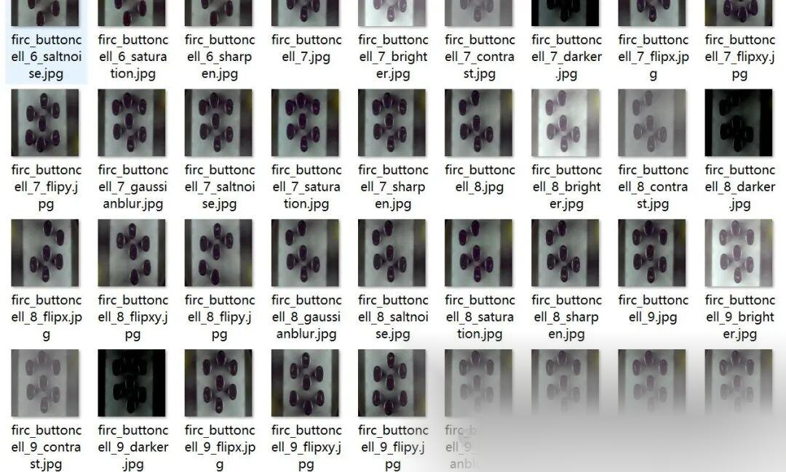
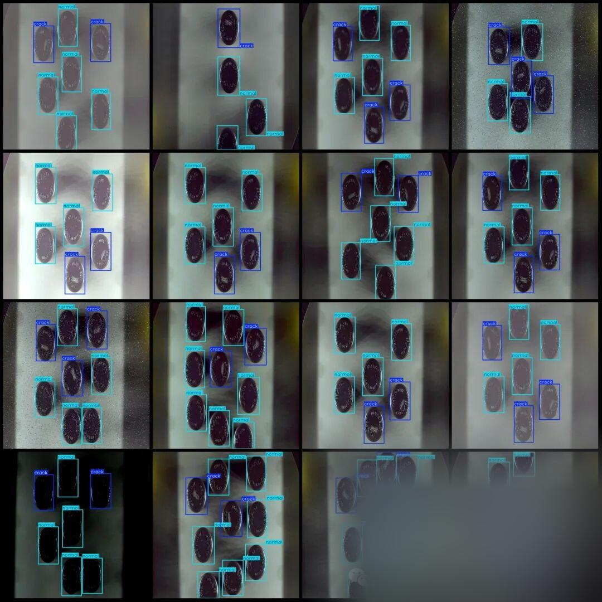

# Button Battery Defect Detection Dataset VOC+YOLO format with 220 images in 2 categories

Dataset 20 are the original images, and the remaining ones are enhanced images. The enhancement tool is self-developed software.

# VOC dataset enhancement tool

Dataset format: Pascal VOC format + YOLO format (txt file without split path, only containing jpg images and corresponding VOC format xml files and yolo format txt files)

Number of images (number of jpg files): 220

Number of annotations (number of xml files): 220

Number of annotations (number of txt files): 220

Labeling category count: 2

Label category names (note that the order of categories in the YOLO format does not correspond to this, but is based on the labels folder's classes.txt): ["crack", "normal"]

Number of boxes labeled in each category:

Crack frame count = 539

Normal frame count = 1012

Total frames: 1551

Using labelImg:

Annotation rules: Draw a rectangle around the category.

Important Notice: No

Special : This dataset does not guarantee the accuracy or precision of the trained models or weight files. The dataset is provided with accurate and reasonable annotations only.

Image Preview:

Annotation Examples (randomly select 16 images for display):

## Payment

Here is a pay link on Stripe ( https://buy.stripe.com/3cs8yP7sY87d0vu9AB ). Please contact me lonlonago@foxmail.com after funding $89, and I will send you a complete data files , thank you!

